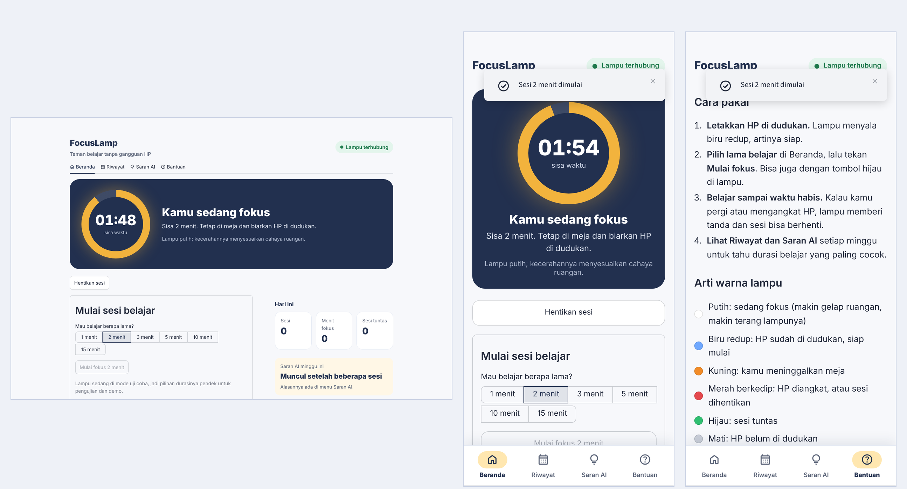
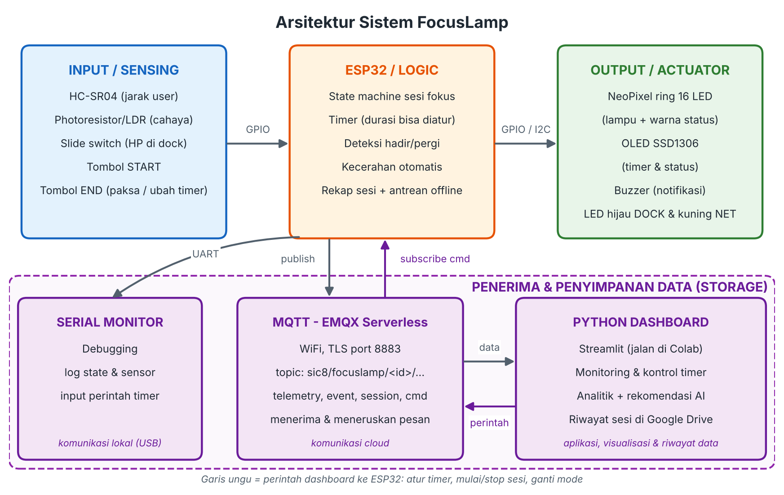
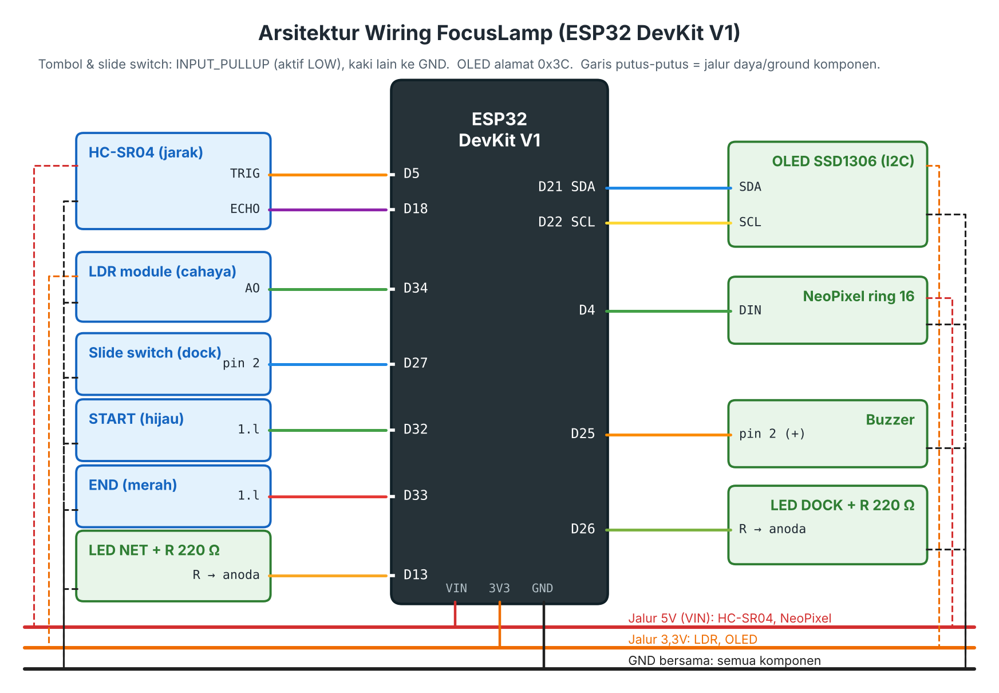
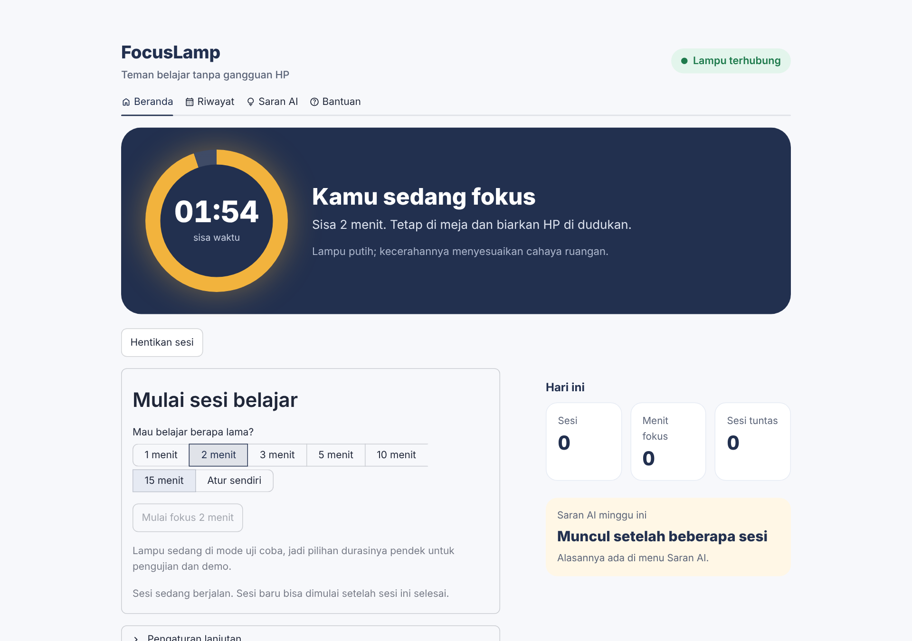
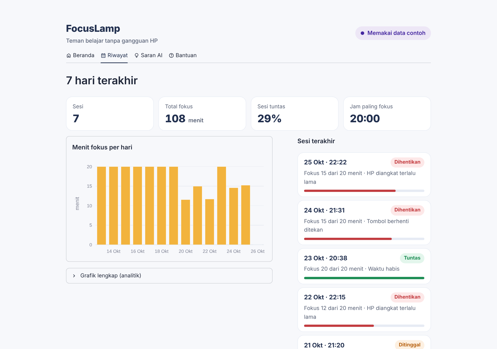
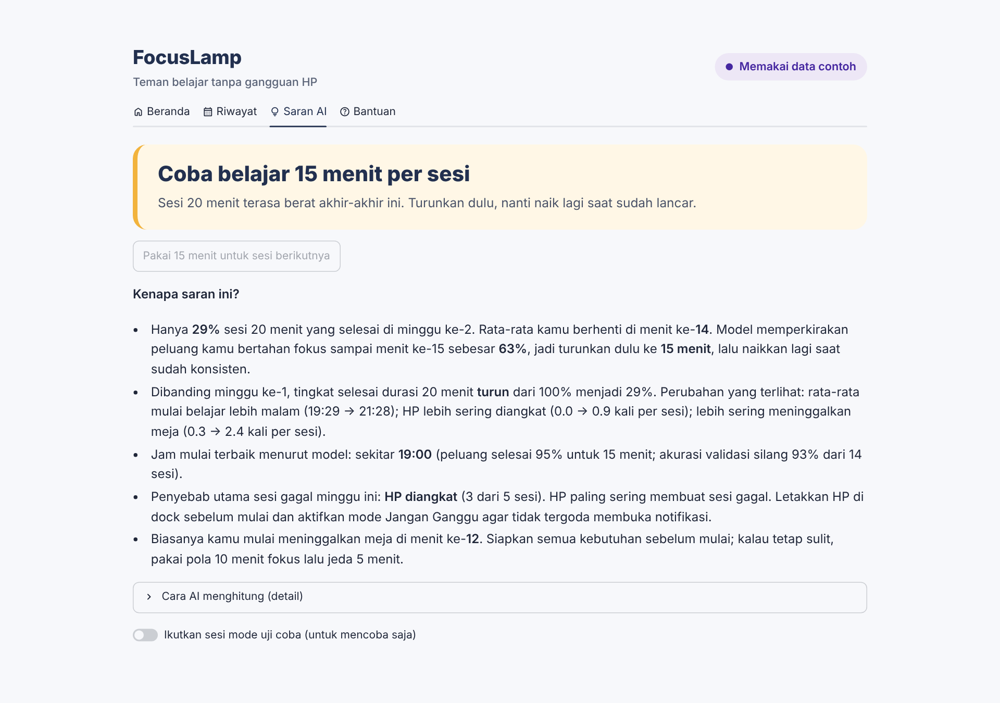
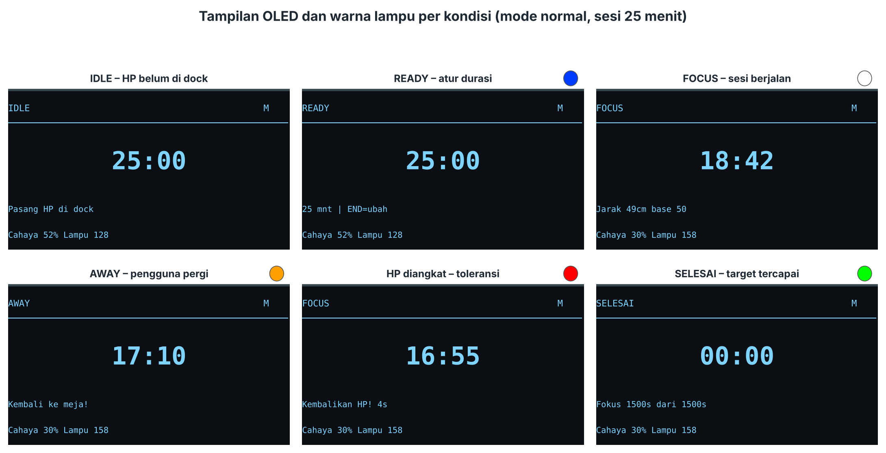

# FocusLamp

Lampu belajar IoT berbasis ESP32 yang hanya menyala ketika HP diletakkan di dudukan (dock). FocusLamp menjalankan sesi fokus dengan timer yang bisa diatur dan mendeteksi apakah pengguna masih di meja (sensor ultrasonik, tanpa kamera). Kecerahan lampu menyesuaikan cahaya ruangan. Setiap sesi dikirim lewat MQTT ke web dashboard yang memberi saran durasi belajar mingguan berbasis AI.

Proyek Samsung Innovation Campus Batch 8, Selection Phase 2 (IoT). Prototipe disimulasikan di [Wokwi](https://wokwi.com).



## Fitur

- **HP sebagai kunci lampu.** Lampu menyala hanya saat HP di dock. Kalau HP diangkat di tengah sesi lebih lama dari batas toleransi, sesi dihentikan.
- **Timer sesi fleksibel.** Durasi bisa diatur lewat tombol di lampu, Serial Monitor, atau web (pilihan cepat atau durasi bebas 1–180 menit).
- **Deteksi kehadiran.** HC-SR04 mendeteksi pengguna meninggalkan meja, dengan filter median dan waktu konfirmasi supaya tahan noise.
- **Kecerahan otomatis.** LDR membaca cahaya ruangan: makin gelap ruangan, makin terang lampunya.
- **Indikator di alat.** NeoPixel menunjukkan status lewat warna, OLED menampilkan timer, buzzer memberi nada, LED DOCK menandai HP di dock, dan LED NET menandai status koneksi.
- **Tahan koneksi putus.** Alat tetap berjalan tanpa internet. Rekap sesi disimpan di antrean lalu dikirim ulang setelah MQTT tersambung lagi.
- **Web dashboard Streamlit.** Ada empat menu (Beranda, Riwayat, Saran AI, Bantuan). Tampilannya responsif: di HP menu pindah ke bawah seperti aplikasi.
- **Saran AI mingguan.** Saran durasi dihitung dari perbandingan mingguan, kurva peluang bertahan fokus (Kaplan–Meier berbobot waktu), dan Logistic Regression untuk jam belajar terbaik.

## Arsitektur



```
ESP32 (Wokwi) ──MQTT/TLS 8883──▶ EMQX Serverless ──▶ Web Streamlit (Colab/laptop) ──▶ Google Drive (riwayat_sesi.csv)
      ▲                                                     │
      └──────────────────── perintah (topic cmd) ◀──────────┘
```

## Struktur folder

```
focuslamp/
├── wokwi/
│   ├── sketch.ino          # program utama ESP32: sensor, lampu, OLED, buzzer, LED, WiFi, MQTT, antrean sesi
│   ├── focus_logic.h       # state machine sesi fokus (dipisah agar bisa diuji di komputer)
│   ├── diagram.json        # rangkaian Wokwi: ESP32 + 12 komponen
│   └── libraries.txt       # daftar library untuk Wokwi
├── streamlit/
│   ├── app.py                         # tampilan web (Beranda, Riwayat, Saran AI, Bantuan)
│   ├── focuslamp_core.py              # koneksi MQTT, penyimpanan riwayat, grafik, rekomendasi AI
│   ├── FocusLamp_Streamlit_Colab.ipynb # menjalankan web dari Google Colab + link publik
│   ├── requirements.txt
│   ├── static/                        # ikon dan manifest (web bisa dipasang di layar utama HP)
│   └── .streamlit/
│       ├── config.toml
│       └── secrets.toml.example       # contoh kredensial untuk menjalankan di laptop
├── tests/
│   └── test_logic.cpp      # uji otomatis state machine (53 pengecekan)
└── docs/images/            # diagram dan screenshot
```

## Komponen dan pin

| Komponen | Pin ESP32 | Keterangan |
| --- | --- | --- |
| HC-SR04 | TRIG GPIO5, ECHO GPIO18 | Jarak pengguna |
| Modul LDR | AO GPIO34 | Cahaya ruangan (ADC1) |
| Slide switch | GPIO27 | Mewakili HP di dock (LOW = di dock) |
| Tombol START (hijau) | GPIO32 | INPUT_PULLUP |
| Tombol END (merah) | GPIO33 | Hentikan sesi / ubah durasi saat READY |
| NeoPixel ring 16 LED | GPIO4 | Lampu + warna status |
| OLED SSD1306 128×64 | SDA GPIO21, SCL GPIO22 | Alamat I2C 0x3C |
| Buzzer | GPIO25 | Nada notifikasi |
| LED hijau DOCK + 220 Ω | GPIO26 | HP di dock |
| LED kuning NET + 220 Ω | GPIO13 | Status WiFi/MQTT |



## Cara menjalankan

### 1. Siapkan broker MQTT (EMQX Serverless, gratis)

1. Daftar di [EMQX Cloud](https://www.emqx.com/en/cloud), lalu buat deployment **Serverless** (tanpa kartu kredit).
2. Catat **Address** di halaman Overview, lalu buat username dan password di **Access Control > Authentication**.
3. (Opsional) Uji dengan [MQTTX](https://mqttx.app): `mqtts://` port 8883, subscribe `sic8/focuslamp/fl-01/#`.

### 2. Simulasi di Wokwi

1. Buat proyek ESP32 baru di Wokwi.
2. Salin isi `wokwi/sketch.ino` dan `wokwi/diagram.json`, lalu tambahkan file `focus_logic.h` dan `libraries.txt`.
3. Isi bagian **1. KONFIGURASI** di `sketch.ino`:
   ```cpp
   const char* MQTT_HOST = "xxxxxxxx.ala.asia-southeast1.emqxsl.com";
   const char* MQTT_USER = "username";
   const char* MQTT_PASS = "password";
   ```
   Kalau ingin mencoba tanpa broker dulu, ubah `USE_MQTT = false`.
4. Jalankan simulasi. Saat mulai, LED DOCK dan LED NET menyala 0,6 detik (tes kabel). Setelah tersambung, Serial menampilkan `[MQTT] tersambung` dan pojok kanan atas OLED menampilkan `M`.

### 3. Web dashboard dari Google Colab (disarankan)

1. Upload `streamlit/FocusLamp_Streamlit_Colab.ipynb` ke Google Colab.
2. Simpan password EMQX di **Secrets** (ikon kunci) dengan nama `MQTT_PASSWORD`, lalu isi `BROKER` dan `USERNAME` di sel 2.
3. Jalankan sel 1 sampai 5. Sel 5 menampilkan link `https://….trycloudflare.com` yang bisa dibuka dari laptop maupun HP.

### 4. Web dashboard di laptop

```bash
cd streamlit
pip install -r requirements.txt
cp .streamlit/secrets.toml.example .streamlit/secrets.toml   # lalu isi kredensial EMQX
streamlit run app.py
```

### 5. Uji logika state machine

```bash
cd tests
g++ -std=c++11 -o test_logic test_logic.cpp && ./test_logic
# 53 checks passed, 0 failed
```

## Cara pakai

1. Letakkan HP di dock (di Wokwi: geser slide switch). Lampu menyala biru redup (READY).
2. Pilih durasi di web lalu tekan **Mulai fokus**, atau tekan tombol START di lampu.
3. Belajar sampai waktu habis. Selama sesi, kontrol cukup lewat tombol di lampu karena HP berada di dock.
4. Lihat **Riwayat** dan **Saran AI** setiap minggu.

| Warna lampu | Arti |
| --- | --- |
| Mati | HP belum di dock (IDLE) |
| Biru redup | HP di dock, siap mulai (READY) |
| Putih | Sesi berjalan (FOCUS), kecerahan mengikuti cahaya ruangan |
| Kuning | Pengguna meninggalkan meja (AWAY) |
| Merah berkedip | HP diangkat saat sesi, atau sesi dihentikan |
| Hijau | Sesi tuntas |

**Perintah Serial Monitor:** `25` (atur timer 25 menit), `start`, `start 10`, `stop`, `demo`, `normal`, `putus` / `sambung` (simulasi koneksi putus), `help`.

## Topic MQTT

Pola: `sic8/focuslamp/<device_id>/<jenis>` dengan `device_id` = `fl-01`, payload JSON.

| Topic | Arah | Isi |
| --- | --- | --- |
| `.../status` | ESP32 → broker (retain) | State, sisa waktu, durasi, session_id, mode |
| `.../telemetry` | ESP32 → broker | Jarak, hadir, dock, cahaya, kecerahan, waktu |
| `.../event` | ESP32 → broker | SESSION_START, AWAY_START, DOCK_LIFTED, SESSION_END, dst. |
| `.../session` | ESP32 → broker | Rekap satu sesi (`queued: true` bila dikirim ulang dari antrean) |
| `.../cmd` | Dashboard → ESP32 | `set_duration`, `start`, `stop`, `set_mode` |

Contoh perintah: `{"action":"start","duration_min":25}`

## Tampilan

| Beranda | Riwayat | Saran AI |
| --- | --- | --- |
|  |  |  |



## Pengujian

14 skenario diuji di Wokwi dan semuanya lulus. Skenario mencakup mulai tanpa HP, pergi/kembali, noise jarak, sesi ditinggal, HP diangkat, hentikan paksa, sesi selesai, perubahan cahaya, mulai dari web, password MQTT salah, dan koneksi putus saat sesi. Logika state machine juga diuji otomatis dengan `tests/test_logic.cpp`.

## Catatan keamanan

- Jangan meng-commit password EMQX. `secrets.toml` sudah di-`.gitignore`, dan placeholder di `sketch.ino` sebaiknya tetap `ISI_...` saat di-push.
- Koneksi MQTT memakai TLS (port 8883). Validasi sertifikat (`setInsecure()`) dilewati sebagai penyederhanaan prototipe.
